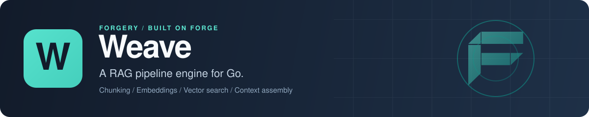

<p align="center">
  
</p>

# Weave: RAG pipeline engine for Go

Weave is an open-source Go library for retrieval-augmented generation (RAG). You hand it documents, and it chunks the text, generates embeddings, writes the vectors to a vector store such as pgvector, then retrieves the closest chunks for a query and assembles them into prompt context with a token budget and citation markers. Collections, documents and chunks are tenant-scoped and live in PostgreSQL, SQLite, MongoDB or memory, and the whole engine runs standalone or as a [Forge](https://github.com/xraph/forge) extension with an HTTP API.

[](https://go.dev/dl/) [](https://github.com/xraph/weave/actions/workflows/ci.yml) [](https://pkg.go.dev/github.com/xraph/weave) [](https://github.com/xraph/weave/stargazers)

[Documentation](https://www.xraph.com/docs/weave) · [Quick start](#quick-start) · [Features](#why-weave) · [Components](#pipeline-components) · [Storage](#storage) · [Forge](#use-it-with-forge) · [FAQ](#faq)

## Quick start

You need [Go 1.26 or later](https://go.dev/dl/) and an OpenAI API key for the embeddings.

```bash
go get github.com/xraph/weave@latest
```

Save this as `main.go`:

```go
package main

import (
	"context"
	"fmt"
	"log"
	"os"

	"github.com/xraph/weave/chunker"
	"github.com/xraph/weave/collection"
	"github.com/xraph/weave/embedder"
	"github.com/xraph/weave/engine"
	"github.com/xraph/weave/store/memory"
	vsmemory "github.com/xraph/weave/vectorstore/memory"
)

func main() {
	ctx := context.Background()

	eng, err := engine.New(
		engine.WithStore(memory.New()),
		engine.WithVectorStore(vsmemory.New()),
		engine.WithEmbedder(embedder.NewOpenAIEmbedder(os.Getenv("OPENAI_API_KEY"))),
		engine.WithChunker(chunker.NewRecursiveChunker()),
	)
	if err != nil {
		log.Fatal(err)
	}
	defer eng.Stop(ctx)

	col := &collection.Collection{Name: "handbook"}
	if err := eng.CreateCollection(ctx, col); err != nil {
		log.Fatal(err)
	}

	res, err := eng.Ingest(ctx, &engine.IngestInput{
		CollectionID: col.ID,
		Title:        "Leave policy",
		Content: "Full-time staff get 25 days of paid leave a year. " +
			"Unused days carry over until the end of March. " +
			"Requests longer than two weeks need approval from your manager.",
	})
	if err != nil {
		log.Fatal(err)
	}
	fmt.Printf("ingested %s into %d chunks\n", res.DocumentID, res.ChunkCount)

	hits, err := eng.Retrieve(ctx, "How many vacation days do I get?",
		engine.WithCollection(col.ID),
		engine.WithTopK(3),
	)
	if err != nil {
		log.Fatal(err)
	}

	prompt, err := eng.Assemble(ctx, hits, engine.AssembleParams{MaxTokens: 1024})
	if err != nil {
		log.Fatal(err)
	}
	fmt.Println(prompt.Context)
}
```

Run it:

```bash
go mod tidy
OPENAI_API_KEY=sk-... go run .
```

You'll see the document's TypeID (`doc_...`) and its chunk count, then the context block Weave built from the best hits, with a `[1]`-style marker in front of each chunk. That block is what you paste into your LLM prompt. `prompt.Included` tells you which hit each marker points at, so you can show citations next to the answer.

Everything here lives in memory and disappears when the program exits. Swap in a [Postgres store and pgvector](#storage) when you want to keep it.

## Why Weave?

A RAG feature looks small until you build it: you need a chunking strategy, an embedding call, somewhere to keep vectors, a ranking step, a way to fit the results into a context window, and tenant isolation across all of it. Weave puts those steps behind one `engine.Engine`, and each step is a Go interface you can replace with your own.

| You need | Weave gives you |
| --- | --- |
| Text out of files | Loaders for plain text, Markdown, HTML, CSV, JSON, URLs and whole directories |
| Chunks that fit an embedding model | Recursive, fixed-size, sliding-window, sentence-based semantic and code-aware chunkers, with size and overlap per collection |
| Embeddings | An OpenAI embedder (any OpenAI-compatible endpoint through `WithOpenAIBaseURL`), or your own `embedder.Embedder` |
| Vector search | In-memory, PostgreSQL with pgvector, or [Fabriq](https://github.com/xraph/fabriq)'s vector plane |
| Better ranking than plain similarity | MMR for diversity, hybrid retrieval with Reciprocal Rank Fusion, and a reranker wrapper |
| Prompt context that fits | Token-budgeted assembly with `[n]` citation markers |
| One index per customer | Tenant and app IDs on the context, carried into every store and vector query |
| Hooks into your own systems | 14 lifecycle hooks, a [Chronicle](https://github.com/xraph/chronicle) audit bridge and a metrics extension |
| Seeing what it does | OpenTelemetry spans for ingest, embedding, vector search, retrieval and reindex, plus duration and GenAI token metrics on your Forge app's `/_/metrics` |
| An API without writing handlers | Forge routes for collections, documents, retrieval and search, with OpenAPI metadata |

## Pipeline components

`engine.New` takes one option per step. You have to give it a store, a vector store, an embedder and a chunker before you can ingest anything. If you forget one, `Ingest` tells you with `weave.ErrNoStore`, `ErrNoEmbedder` and friends.

| Step | Option | Built in |
| --- | --- | --- |
| Metadata store | `engine.WithStore` | `store/memory`, `store/postgres`, `store/sqlite`, `store/mongo` |
| Vector store | `engine.WithVectorStore` | `vectorstore/memory`, `vectorstore/pgvector`, `vectorstore/fabriq` |
| Embedder | `engine.WithEmbedder` | `embedder.NewOpenAIEmbedder(apiKey, opts...)` |
| Chunker | `engine.WithChunker` | `NewRecursiveChunker`, `NewFixedChunker`, `NewSlidingChunker`, `NewSemanticChunker`, `NewCodeChunker` |
| Loader | `engine.WithLoader` | `NewTextLoader`, `NewMarkdownLoader`, `NewHTMLLoader`, `NewCSVLoader`, `NewJSONLoader(fields...)`, `NewURLLoader(delegate)`, `NewDirectoryLoader(loaders...)` |
| Retriever | `engine.WithRetriever` | `NewSimilarityRetriever`, `NewMMRRetriever`, `NewHybridRetriever`, `NewRerankerRetriever` |
| Hooks | `engine.WithExtension` | `audit_hook`, `observability` |
| Metrics | `engine.WithMetrics` | any go-utils metrics sink; the Forge extension passes the app's |
| Defaults | `engine.WithConfig` | `weave.DefaultConfig()` |

A loader only runs when the `IngestInput` names a `SourceType` the loader supports, such as `text/markdown` or `text/html`. Without one, Weave chunks `Content` as it is.

`embedder.NewLocalEmbedder` exists, but it's a placeholder that returns `ErrNotImplemented`. Until a local model lands, use the OpenAI embedder against any compatible server, or implement the two-method `embedder.Embedder` interface yourself.

### Retrieval

With no retriever option, `Retrieve` embeds the query and searches the vector store directly. Every hit is then read back from the metadata store by chunk ID, and a hit whose row has gone missing stays in the results with `Orphaned` set.

When plain similarity isn't enough, compose retrievers:

```go
st := postgres.New(db)
vs := pgvector.New(db)
emb := embedder.NewOpenAIEmbedder(apiKey)

eng, err := engine.New(
	engine.WithStore(st),
	engine.WithVectorStore(vs),
	engine.WithEmbedder(emb),
	engine.WithChunker(chunker.NewRecursiveChunker()),
	engine.WithRetriever(retriever.NewHybridRetriever(
		retriever.NewSimilarityRetriever(vs, emb, st),
		retriever.NewMMRRetriever(vs, emb, 0.5),
	)),
)
```

`Retrieve` takes `WithCollection`, `WithTopK`, `WithMinScore`, `WithTenantID` and `WithTenantFilter`. For a query across several collections, use `eng.HybridSearch(ctx, query, &engine.HybridSearchParams{...})`. `eng.RetrieveCompare` puts your configured ranking next to the raw vector ranking for the same query, so you can see what a reranker or MMR actually moved.

### Context assembly

`eng.Assemble(ctx, hits, engine.AssembleParams{MaxTokens: n})` builds the context string in rank order until the budget runs out (4096 tokens when you pass zero). It returns `Context`, `TotalTokens`, `Included` (which hits made it in, in marker order) and `FirstExcluded`. If you want your own template or token counter, use the `assembler` package directly with `assembler.WithTemplate`, `WithTokenCounter` and `WithMaxTokens`.

## Storage

You configure two stores. The metadata store holds collections, documents and chunks, and the vector store holds the embeddings, which is why you can mix them: SQLite for metadata with vectors in memory on a laptop, or Postgres for both in production.

| Metadata store | Package | Notes |
| --- | --- | --- |
| PostgreSQL | `store/postgres`, `postgres.New(db *grove.DB)` | Grove migrations, run by `Migrate` |
| SQLite | `store/sqlite`, `sqlite.New(db *grove.DB)` | Single node, pair it with the in-memory vector store |
| MongoDB | `store/mongo`, `mongo.New(db *grove.DB)` | |
| Memory | `store/memory`, `memory.New()` | Tests and prototypes |

| Vector store | Package | Notes |
| --- | --- | --- |
| pgvector | `vectorstore/pgvector`, `pgvector.New(db *grove.DB, opts...)` | Table `weave_vectors` by default, change it with `WithTableName` |
| Fabriq | `vectorstore/fabriq` (package `fabriqvec`), `fabriqvec.New(vq, opts...)` | Embeddings live in Fabriq next to the rest of your data |
| Memory | `vectorstore/memory`, `memory.New()` | Tests and prototypes |

Call `Migrate(ctx)` on the metadata store before first use (the Forge extension does it for you on start). The pgvector store has no migration of its own, so create the `vector` extension and the `weave_vectors` table in your own schema migrations before the first ingest.

All stores are built on [Grove](https://github.com/xraph/grove), so you open one `*grove.DB` and share it between the metadata store and pgvector.

## Multi-tenancy

Put the tenant and app on the context, and Weave scopes everything under it:

```go
ctx = weave.WithTenant(ctx, "acme")
ctx = weave.WithApp(ctx, "support-bot")
```

A collection created under that context belongs to `acme`, and `Retrieve` filters the vector search by the same tenant. If you need to query one tenant explicitly from a context that has none, pass `engine.WithTenantFilter("acme")`. Unlike `WithTenantID`, an empty string there means rows with no tenant, not everyone.

## Use it with Forge

The `extension` package registers Weave as a Forge extension. On `Register` it reads config from `extensions.weave` (or the older `weave` key), takes a store from a `*grove.DB` in the container when there is one, builds the engine, mounts the HTTP API under `/weave`, and provides `*engine.Engine` to the container. `Start` runs the store migration.

```go
import (
	"github.com/xraph/forge"
	"github.com/xraph/weave/chunker"
	"github.com/xraph/weave/embedder"
	"github.com/xraph/weave/engine"
	weaveext "github.com/xraph/weave/extension"
	"github.com/xraph/weave/store/memory"
	vsmemory "github.com/xraph/weave/vectorstore/memory"
)

app := forge.NewApp(forge.AppConfig{
	Name:        "search-api",
	HTTPAddress: ":8080",
	Extensions: []forge.Extension{
		weaveext.New(
			weaveext.WithStore(memory.New()), // leave out when Grove is in the container
			weaveext.WithVectorStore(vsmemory.New()),
			weaveext.WithEngineOption(engine.WithEmbedder(embedder.NewOpenAIEmbedder(os.Getenv("OPENAI_API_KEY")))),
			weaveext.WithEngineOption(engine.WithChunker(chunker.NewRecursiveChunker())),
		),
	},
})
```

The extension has no embedder or chunker option of its own, so you pass those through `WithEngineOption`. Other extensions resolve the engine with `forge.Inject[*engine.Engine](app.Container())`.

### Configuration

```yaml
extensions:
  weave:
    base_path: /weave
    default_chunk_size: 512
    default_chunk_overlap: 50
    default_embedding_model: text-embedding-3-small
    default_chunk_strategy: recursive
    default_top_k: 10
    ingest_concurrency: 4
    shutdown_timeout: 30s
    grove_database: ""      # a named grove.DB; empty uses the default one
    disable_routes: false
    disable_migrate: false
```

Those values are the defaults. `default_chunk_overlap` has to be smaller than `default_chunk_size`, or `Register` fails. In code, the same settings go through `WithConfig`, `WithBasePath`, `WithGroveDatabase`, `WithDisableRoutes`, `WithDisableMigrate` and `WithRequireConfig(true)`, and `WithExtension` adds a lifecycle hook.

### HTTP API

With the default base path, the routes are:

| Method and path | Does |
| --- | --- |
| `POST /weave/v1/collections`, `GET /weave/v1/collections` | Create or list collections |
| `GET /weave/v1/collections/:collectionId`, `DELETE ...` | Read or delete one, with its documents and chunks |
| `GET /weave/v1/collections/:collectionId/stats` | Document and chunk counts |
| `POST /weave/v1/collections/:collectionId/reindex` | Re-embed every chunk |
| `POST /weave/v1/collections/:collectionId/documents`, `.../documents/batch` | Ingest one document or a batch |
| `GET /weave/v1/collections/:collectionId/documents` | List documents |
| `GET /weave/v1/documents/:documentId`, `DELETE ...` | Read or delete a document |
| `POST /weave/v1/collections/:collectionId/retrieve` | Retrieve from one collection |
| `POST /weave/v1/search` | Search across collections |

The routes carry OpenAPI metadata, so they show up in your Forge app's spec. The extension also contributes a `weave` page to the [Forge dashboard](https://github.com/xraph/forge-dashboard).

## Lifecycle hooks

You write a hook as any value that implements one or more of these methods, and you add it with `engine.WithExtension`:

| Area | Hooks |
| --- | --- |
| Collections | `OnCollectionCreated`, `OnCollectionDeleted` |
| Ingestion | `OnIngestStarted`, `OnIngestChunked`, `OnIngestEmbedded`, `OnIngestCompleted`, `OnIngestFailed` |
| Retrieval | `OnRetrievalStarted`, `OnRetrievalCompleted`, `OnRetrievalFailed` |
| Documents and reindex | `OnDocumentDeleted`, `OnReindexStarted`, `OnReindexCompleted` |
| Shutdown | `OnShutdown` |

`audithook.New(recorder)` (import path `github.com/xraph/weave/audit_hook`) turns these into audit events for Chronicle or any `Recorder`, and `observability.NewMetricsExtension()` counts ingests, retrievals and failures.

## Telemetry

You don't need a hook for tracing. The engine starts OpenTelemetry spans for its own work (`ingest document`, `embed texts`, `search vectors`, `retrieve chunks`, `reindex collection` and a few more) on the global tracer provider, so in a Forge app they sit under the request's server span. With a metrics sink it also records ingest, retrieval and vector store durations and the GenAI client metrics for every embedding call. The Forge extension wires the app's metrics and logger in for you; outside Forge, pass `engine.WithMetrics`. No span or label carries query text, document content, tenant IDs or keys. The [observability page](https://www.xraph.com/docs/weave/subsystems/observability) lists every span, metric and label value.

## Documentation

| Topic | Read |
| --- | --- |
| First pipeline | [Getting started](https://www.xraph.com/docs/weave/getting-started), [architecture](https://www.xraph.com/docs/weave/architecture), [end-to-end example](https://www.xraph.com/docs/weave/guides/full-example) |
| Ingestion | [Document ingestion](https://www.xraph.com/docs/weave/subsystems/ingestion), [loaders](https://www.xraph.com/docs/weave/subsystems/loader), [chunkers](https://www.xraph.com/docs/weave/subsystems/chunker), [embedders](https://www.xraph.com/docs/weave/subsystems/embedder) |
| Retrieval and context | [Semantic retrieval](https://www.xraph.com/docs/weave/subsystems/retrieval), [context assembler](https://www.xraph.com/docs/weave/subsystems/assembler) |
| Storage | [PostgreSQL](https://www.xraph.com/docs/weave/stores/postgres), [SQLite](https://www.xraph.com/docs/weave/stores/sqlite), [MongoDB](https://www.xraph.com/docs/weave/stores/mongo), [Fabriq vectors](https://www.xraph.com/docs/weave/stores/fabriq) |
| Tenants and config | [Multi-tenancy](https://www.xraph.com/docs/weave/concepts/multi-tenancy), [configuration](https://www.xraph.com/docs/weave/concepts/configuration) |
| Forge and HTTP | [Forge extension](https://www.xraph.com/docs/weave/guides/forge-extension), [HTTP API](https://www.xraph.com/docs/weave/api-reference/http-api) |
| Extending it | [Extension system](https://www.xraph.com/docs/weave/subsystems/plugins), [custom components](https://www.xraph.com/docs/weave/guides/custom-store) |

The Go API is on [pkg.go.dev](https://pkg.go.dev/github.com/xraph/weave).

## FAQ

### How do I build a RAG pipeline in Go?

Create an `engine.Engine` with a store, a vector store, an embedder and a chunker, then call `Ingest` for each document, `Retrieve` for each question and `Assemble` to turn the hits into prompt context. The [quick start](#quick-start) is the whole loop in about sixty lines.

### Does Weave work with pgvector?

Yes. `vectorstore/pgvector` stores embeddings in a Postgres table through Grove and searches by vector distance. Create the `vector` extension and the `weave_vectors` table yourself, since Weave doesn't migrate it.

### Can I use Weave without Forge?

Yes. `engine`, the stores and every component are plain Go. Only `extension` and `api` import Forge.

### Which embedding models does Weave support?

The built-in embedder calls OpenAI's embeddings API, `text-embedding-3-small` by default, and `WithOpenAIModel`, `WithOpenAIDimensions` and `WithOpenAIBaseURL` let you point it at another model or any OpenAI-compatible server. Anything else works through your own `embedder.Embedder`.

### How do I keep one customer's documents out of another's results?

Set the tenant on the context with `weave.WithTenant`. Collections, documents and chunks are stored under it, and retrieval filters the vector search to it.

## Contributing

Issues and focused pull requests are welcome. Open an [issue](https://github.com/xraph/weave/issues) first for anything large.

```bash
git clone https://github.com/xraph/weave.git
cd weave
GOWORK=off go build ./...
make test     # go test -v ./...
make lint     # golangci-lint v2
make fmt      # gofmt and goimports
```

Postgres and MongoDB store tests skip unless you set `WEAVE_TEST_POSTGRES_DSN` or `WEAVE_TEST_MONGO_DSN`, and they refuse the default ports, so point them at throwaway containers. Skip `make build`, `make run` and `make dev`, which point at a `cmd/weave` that doesn't exist. [AGENTS.md](AGENTS.md) has the CI jobs, test setup and release steps. Commits follow [Conventional Commits](https://www.conventionalcommits.org/) with a scope, as in `fix(engine): ...`.

## License

See the [Weave repository](https://github.com/xraph/weave) for license terms.

Weave is part of the [forgery stack](https://github.com/xraph/forge#the-forgery-stack) built on [Forge](https://github.com/xraph/forge), by [Rex Raphael](https://github.com/juicycleff) and [contributors](https://github.com/xraph/weave/graphs/contributors).
